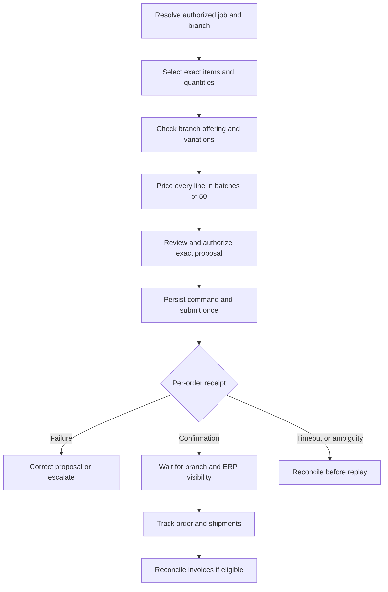

# ABC Supply API orchestration and handoff contracts

Review date: November 27, 2026. Version 0.1.0.

This pack covers the official public documentation at https://apidocs.abcsupply.com/: seven API families, 32 endpoint pages, 33 callable method/path variants, and two inbound event contracts. Get Order has two documented lookup variants. No authenticated API calls were made, no production data was accessed, and no operational mutations were executed.

The operation catalog is a documentation-derived reference, not an official OpenAPI export or a certified production client. The internal envelopes and workflow rules are proposed implementation contracts. Unresolved provider contradictions are preserved rather than silently repaired. All operations remain disabled for production pending sandbox acceptance.

## 1. CRUD boundary

| API family | Create | Read / calculation | Update | Delete |
|---|---|---|---|---|
| Order | Submit orders | Details by order or confirmation; history; template list/detail | No documented existing-order update | No documented cancel/delete |
| Pricing | None | Price Items uses POST for a read calculation | None | None |
| Account | None documented | Search; Sold-To; Bill-To; Ship-To; contacts | No documented account/contact write | None documented |
| Product | Add favorite membership via PUT | Catalog; search; item; availability; favorites; recent/frequent; hierarchy; image | No documented product-master update | No documented favorite removal or product deletion |
| Location | None | Branch search/detail | None | None |
| Notification | Register webhook | List/get webhook | PATCH webhook | Unregister webhook |
| Invoice | None | History; JSON detail; PDF | None | None |

POST is not synonymous with Create. Search Accounts, Search Items, Search Item Availability and Price Items are read operations by purpose. Add Favorite is a mutation even though its documented scope is product.read. Order events can describe cancellations or returns without exposing an API command to initiate them. The home page's general claim about updating job contacts is not enough to invent a contact-write contract.

Local draft, proposal, preference or exception records can have full CRUD in your own database. Those actions must be named and audited as local changes.

## 2. API registry and base URLs

Use https://partners-sb.abcsupply.com for sandbox and https://partners.abcsupply.com for production. Never derive environment from a sample hyperlink or let agent input choose a hostname. All paths below include their API family/version prefix. The contacts route needs confirmation because the visible resource and request example disagree.

| Operation ID | Method | Full path | Endpoint scope |
|---|---|---|---|
| `place_orders` | POST | `/api/order/v2/orders` | `order.write` |
| `get_order_by_number` | GET | `/api/order/v2/orders/{orderNumber}` | `order.read` |
| `get_order_by_confirmation` | GET | `/api/order/v2/orders` | `order.read` |
| `get_order_history` | GET | `/api/order/v2/orders/orderHistory` | `order.read` |
| `get_order_templates` | GET | `/api/order/v2/orders/templates` | `order.read` |
| `get_order_template` | GET | `/api/order/v2/orders/templates/{templateId}` | `order.read` |
| `price_items` | POST | `/api/pricing/v2/prices` | `pricing.read` |
| `search_accounts` | POST | `/api/account/v1/search/accounts` | `account.read` |
| `get_sold_to` | GET | `/api/account/v1/soldtos/{soldToNumber}` | `account.read` |
| `get_bill_to` | GET | `/api/account/v1/billtos/{billToNumber}` | `account.read` |
| `get_ship_to` | GET | `/api/account/v1/shiptos/{shipToNumber}` | `account.read` |
| `get_ship_to_contacts` | GET | `/api/accounts/v1/shiptos/{shipToNumber}/contacts` | `account.read` |
| `get_item` | GET | `/api/product/v1/items/{itemNumber}` | `product.read` |
| `get_all_items` | GET | `/api/product/v1/items` | `product.read` |
| `get_favorite_items` | GET | `/api/product/v1/items/{billToNumber}/favorites` | `product.read` |
| `get_recent_items` | GET | `/api/product/v1/items/{billToNumber}/recents` | `product.read` |
| `get_frequent_items` | GET | `/api/product/v1/items/{billToNumber}/frequents` | `product.read` |
| `add_favorite_item` | PUT | `/api/product/v1/items/{billToNumber}/favorites/{itemNumber}` | `product.read` |
| `search_items` | POST | `/api/product/v1/search/items` | `product.read` |
| `search_item_availability` | POST | `/api/product/v1/search/availability/items` | `product.read` |
| `get_item_availability` | GET | `/api/product/v1/availability/items/{itemNumber}/branches` | `product.read` |
| `get_product_hierarchy` | GET | `/api/product/v1/hierarchy` | `product.read` |
| `get_item_image` | GET | `/api/product/v1/items/{assetId}/images` | `product.read` |
| `search_branches` | GET | `/api/location/v1/branches` | `location.read` |
| `get_branch` | GET | `/api/location/v1/branches/{branchNumber}` | `location.read` |
| `register_webhook` | POST | `/api/notification/v2/webhooks` | `notification.write` |
| `get_webhook` | GET | `/api/notification/v2/webhooks/{webhookId}` | `notification.read` |
| `get_webhooks` | GET | `/api/notification/v2/webhooks` | `notification.read` |
| `update_webhook` | PATCH | `/api/notification/v2/webhooks/{webhookId}` | `notification.write` |
| `unregister_webhook` | DELETE | `/api/notification/v2/webhooks/{webhookId}` | `notification.write` |
| `get_invoice_history` | GET | `/api/invoice/v1/invoices/history/{billToAccount}` | `invoice.history.read` |
| `get_invoice` | GET | `/api/invoice/v1/invoices/id/{invoiceId}` | `invoice.read` |
| `get_invoice_pdf` | GET | `/api/invoice/v1/invoices/pdf/{invoiceId}` | `invoice.read` |

## 3. Authorization and account context

ABC documents OAuth 2.0 authorization code, authorization code with PKCE, and client credentials. The production issuer base is https://auth.partners.abcsupply.com/oauth2/ausvvp0xuwGKLenYy357 and sandbox is https://sandbox.auth.partners.abcsupply.com/oauth2/aus1vp07knpuqf6Xz0h8, with /v1/authorize and /v1/token shown in the grant examples. Client credentials uses the token endpoint. Check the client authentication method provisioned for the application; do not assume that a PKCE example means a public client can omit client authentication. OAuth discovery, audience and token validation details should be confirmed from approved integration configuration.

| Integration track | Application token | Customer/user token | Important boundary |
|---|---|---|---|
| Third-party aggregator | Location, general Product, Notification per grant guide | Customer account context, customer-specific Product operations, Pricing and Order | An application token is not a replacement for customer consent or account access |
| Individual Business | Enrolled business access can use client credentials per provisioned scopes | Supported where documented | The grant guide lists allOrder.read; endpoint pages say order.read. Verify the approved profile |
| Invoice GET endpoints | Documented for Individual Business | Within Individual Business authorized access | Current pages explicitly say unavailable to third-party aggregators |

Retain separate Sold-To, Bill-To and Ship-To identifiers. Bill-To supports favorites, recents, frequents, templates and invoice history. Ship-To determines branch association for pricing and ordering. The actual delivery address is separate. Resolve allowed branches from authorized account responses; proximity is not permission. Exclude purchasing account records with no branches, as the overview identifies these as retired ERP records. Never infer account numbers from a suffix convention.

The internal context references credentials and account bindings stored by the server. It does not contain bearer tokens. App-level webhook credentials do not identify a tenant by themselves: map every event to a known connection and authorized account/order record.

## 4. Orchestration model

Each arrow carries a persisted, versioned result with tenant/connection/environment, source evidence and observation time. The agent proposes work; a policy service resolves permissions and a typed adapter constructs the supplier request. UI presents branch/account selection, item/UOM/dimension choices, proposal review, confirmation, pending branch state and exceptions. It must not imply inventory is reserved or delivery is guaranteed.

Independent product reads can run concurrently within rate budgets. Account selection and branch binding precede customer pricing; pricing precedes proposal authorization; authorization precedes order submission. Do not parallelize dependent mutations.

### Handoff contract between harness and adapter

internal-handoff.schema.json is the proposed normative internal request schema. internal-result.schema.json defines normalized outcomes and problems. These wrappers are not sent to ABC. request.body alone contains the supplier JSON body; operation metadata selects a fixed method/path/host and verified token.

The runtime must enforce reference ownership, immutable account/branch bindings, allowlisted parameters, deadlines, canonical payload hashing and atomic command-key claims. A model-authored approvalRef is not evidence until resolved and checked server-side. Version the server hash canonicalization profile; the example digest uses UTF-8 JSON with sorted keys and compact separators over operationId, the full trusted context and request. It is illustrative, not a cross-language canonicalization standard. The local policy proposed here requires exact proposal approval for orders and administrator authorization for webhook management; these are our orchestration controls, not provider API requirements.

An output outcome of succeeded means the requested API operation completed according to its contract. For Place Orders, that means a submission receipt, not completed fulfillment. Delivery status, invoice status and local command execution state are separate dimensions.

### Pricing to order

See pricing-to-order-mapping.md for exact field mappings. A price snapshot must bind line ID, item, quantity, UOM, length, currency, Ship-To and branch. A changed input invalidates the prior proposal and authorization. No provider quote ID, validity period or guaranteed price lock was established. Any freshness window is a configurable local policy, with real-time repricing before submission.

A zero unitPrice can arrive with a successful status when branch pricing is missing, and the overview also notes unavailable items can price at zero. Treat this as a branch-pricing exception, never as free merchandise or proof of availability. ABC can accept a zero-priced or custom-item request for branch review; the standard automated flow proposed here blocks it and routes to a separate reviewed exception. The overview uses description for custom-item details while the endpoint uses itemDescription, so that exception payload also needs confirmation.

The endpoint permits at most 50 pricing lines and 99 order lines. Join returned pricing by line ID; verify duplicates, missing lines, unexpected lines, item and context. A 99-line proposal needs two pricing batches. A 200 response can still contain failed price lines. The pricing quantity is documented integer while order quantity is double; fractional quantities need a verified conversion or provider guidance, never silent rounding.

shipTo.number is the job account. shipTo.name/address/contacts are order delivery information. A template price or stored favorite does not establish current price, offering or a valid delivery contact. Dimensional items require a supported length; non-dimensional items must omit that object. Retain ABC descriptions and provider warning data.

### Order acceptance and idempotency

Place Orders returns HTTP 202. Inspect request.ordersReceived/ordersFailed/ordersSucceded and every orders[] entry. Correlate by requestId and require a confirmationNumber for the receipt path. Partial or inconsistent results are not a success merely because transport returned 202. A failed line-count or ERP-account mismatch may be represented in a 202 response. Do not retry successful orders in a failed batch.

The provider requestId is documented for tracking; no deduplication guarantee or idempotency header was established. The internal command ledger prevents duplicate local execution. If a connection fails after sending, mark the command indeterminate and reconcile via known receipts, webhooks, eligible history and branch support. Do not mark it safely failed or automatically issue a second purchase. Exactly-once external order creation cannot be promised from this evidence.

A confirmation receipt precedes branch acceptance and ERP visibility. Get Order may not return details while the branch reviews the request. Retain a local submitted/awaiting-branch state and show the receipt. Poll reads within a local deadline; absence of details is not authorization to resubmit. Provider timing and rejection details before ERP visibility need acceptance tests.

The release notes say POs longer than 16 characters may be accepted and then truncated downstream: enforce the limit before submission and keep the original local reference. Delivery instructions accept 255 characters at submission but may be abbreviated by the branch to 25 characters in the ERP; do not promise exact text survival.

## 5. Event and webhook contracts

inbound-event-contracts.json contains both event shapes as separate inbound contracts. ORDER_UPDATE is an order snapshot with salesOrder, accounts, lines and shipments. ORDER_INVOICED uses an event/eventType/webhookDetails/data envelope. They are not interchangeable payloads.

Registration supports type ORDER and event arrays containing ORDER_UPDATE and/or ORDER_INVOICED, with a maximum of five registrations per application. GET responses use event as a string. PATCH documents only ORDER_UPDATE, so invoice-event update behavior is blocked pending verification. PATCH omission/null semantics, concurrency and secret rotation rules are not established.

ORDER_UPDATE documents the registration secret in the Authorization header. For ORDER_INVOICED, the registration page names webhookDetails[].apiKey while the event page names Authorization. An implementation must obtain and test an explicit event authentication profile. Do not guess a Bearer prefix, invent an HMAC signature or silently accept either location. Secrets are sensitive even when in JSON: strip them from downstream business data and logs.

Proposed receiver processing is authenticate -> validate -> durably enqueue -> return 200 -> normalize asynchronously. This is a local design, not a documented provider retry or acknowledgment SLA. Duplicate detection and replay handling need local storage. No stable event ID, sequence, delivery-order guarantee or full update timestamp was established; a body hash suppresses identical duplicates only. Preserve observations rather than imposing a simple forward-only status order. Reconcile authoritative reads where authorized; an old snapshot must not overwrite a newer verified state without resolution.

The documented order status sets vary by delivery/pickup/returns. Preserve raw labels. An event reporting Canceled, Backordered, Partial or a credit memo does not imply there is a corresponding public CRUD command. Webhooks cover orders placed through the integration; history can include other orders, and third-party detail access remains limited to the integration's own orders. Invoice REST eligibility and invoice webhook eligibility are separate checks.

## 6. Failures, pagination, catalog and performance

| Condition | Normalized handling |
|---|---|
| Authentication expired | Reauthorize/refresh according to configured grant; no blind mutation replay |
| Account/branch/scope failure | ACCESS_DENIED; correct binding or approved scope profile |
| Price line failure on 200 | PROVIDER_BUSINESS_REJECTED for that line; block complete order proposal |
| Order failure on 202 | Preserve per-order failure and successful receipts separately |
| Timeout after a mutation may have been sent | INDETERMINATE_MUTATION; reconcile_first |
| Missing detail during branch review | pending_visibility for a known submitted order; bounded read polling |
| Order History 502 | May denote account access per this endpoint's docs; inspect semantics before retry |
| Get Webhooks 404 | Documented empty registry; expose no raw secret |
| 429 / transient read failure | Local bounded retry with jitter; honor Retry-After if provided; exact 429 contract not established |
| Undocumented mutation request | UNSUPPORTED_OPERATION; local exception and branch/portal handoff |

Pagination is endpoint-specific. Many responses use itemsPerPage/pageNumber/totalPages/totalItems. Recents and frequents examples use pageSize/pageCount/totalCount. Template list examples do not provide totals. Keep raw pagination, configure per-endpoint adapters and prove termination in sandbox. Do not infer complete enumeration from one page or assume an unsupported cursor. Missing/malformed counters must not produce an infinite loop or silently truncate results.

Get All Items supports a full load and delta via sinceLastModifiedDateTime within the preceding seven days. Full results include Active items; delta can also contain Inactive items. Apply those inactive changes to the local read model and hide them from browsing. Checkpoint only after all pages succeed, and fall back to a full sync when a watermark is too old. No snapshot consistency or catalog deletion guarantee was established. Shared global catalog data must not leak customer-specific prices, favorites or branch permissions.

The overview documents sandbox 10 transactions/sec at client-ID level. The proposed implementation conservatively shares that budget across APIs. Production family rates are Account 20, Product 10, Pricing 50, Order 20, Invoice 10, Location 30 and Notification 10 transactions/sec. Verify the production quota/window/burst model during onboarding. Use shared limiters across workers, bounded queues, cacheable catalog reads and reserved interactive capacity. No latency percentile or end-to-end fulfillment SLA was found; measure these in the pilot rather than presenting quotas as latency guarantees.

## 7. Documentation issues and acceptance gates

The catalog retains 23 issue records, with source and disposition. Route hyperlinks, table types, sample methods, misspelled fields and event secret placement must not be silently copied into a generated SDK. Request fields that lack a required marker are recorded as unspecified; stricter internal requirements are design choices. Response field declarations and strict-JSON example shapes are separate evidence because they often disagree. This pack does not claim an exhaustive response schema.

Before production enablement:

1. Obtain ABC's current Postman collection (the overview says it is available on request) and any provider schema; resolve D01-D23 with their integration team.
2. Establish the integration track, approved client authentication, account enrollment and per-endpoint scope profile; verify invoice eligibility.
3. Exercise every enabled method/path with authorized sandbox fixtures. Record actual headers, body shape, requiredness, errors, pagination termination and binary content. Sandbox mutations require a separately authorized integration test; this review did not execute one.
4. Prove pricing and order outcomes, including 200 price line errors, 202 order business failure, partial batch receipt, ERP mismatch, PO truncation prevention, dimensional rejection and fractional quantity handling.
5. Demonstrate a lost order response without an automatic duplicate purchase; verify later branch acceptance and ERP visibility without resubmission.
6. Validate both event authentication profiles, secrets, receiver acknowledgment behavior, duplicate and reordered deliveries, replay/recovery and cross-tenant/account isolation.
7. Verify webhook create/read/update/delete and readback under ambiguous timeouts, max-five handling, secret rotation and the ORDER_INVOICED PATCH restriction.
8. Measure real rate limiting and latency; set local deadlines, backoff, retries and support escalation. Enable endpoints individually after evidence is recorded.

## 8. Files

- upstream-operation-catalog.json: 33 operation records, exact candidate paths, scopes, declared fields, example shape evidence, preconditions, constraints, mappings and conflicts.
- inbound-event-contracts.json: the two inbound event contracts, source auth disagreements and receiver gates.
- internal-handoff.schema.json and internal-result.schema.json: proposed internal transport contracts.
- draft-wire-profiles.schema.json: strict local subset for order, pricing and webhook writes. Not a provider OpenAPI file.
- orchestration-model.json: step dependencies, outputs, gates, background sync, rate budgets and unsupported commands.
- pricing-to-order-mapping.md: explicit cross-API field mappings.
- example-internal-handoff.json: a synthetic structural example, not real customer data and not an executable purchase fixture.
- source-manifest.json: official URLs, retrieval times and source hashes; raw HTML is not redistributed.
- validation-results.json: local structural checks only. No provider behavior is certified.

All provider evidence is linked per operation and in the source manifest. Primary guide: https://apidocs.abcsupply.com/api-overview/ ; endpoint index: https://apidocs.abcsupply.com/api-endpoints/ ; authentication: https://apidocs.abcsupply.com/authorization-methods/ ; release notes: https://apidocs.abcsupply.com/release-notes/ .
